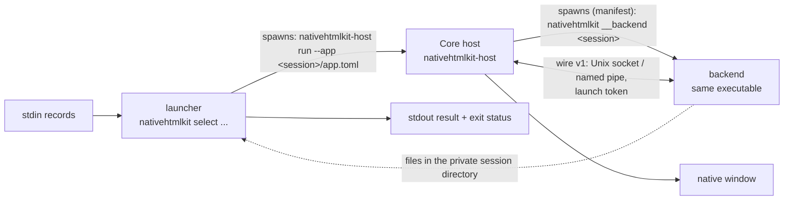
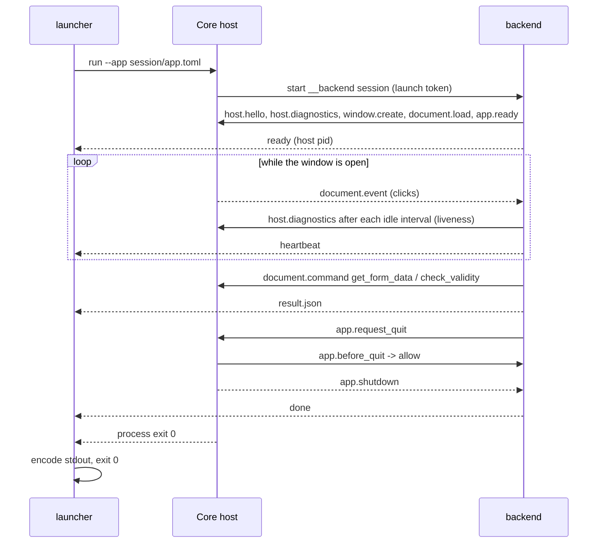

# CLI architecture

How `nativehtmlkit` 0.1.2 turns a pipe into a native window and back into an exit status.
This page explains; the exact contract is in the [reference](REFERENCE.md).

The CLI is a standalone Rust program. It does not draw anything itself: it supervises one
**Core host** session per command over Core's local, authenticated wire protocol v1 (stable
since Core 1.0.3). It depends only on that public protocol, not on Core's source. Command
parsing, input framing, the generated page, output encoding and exit statuses are owned by
this repository; rendering and GUI events are owned by Core. The SDKs neither use nor ship
the CLI.

## Process model

One command runs three processes:

1. **Launcher** (the process you start). It parses the arguments, reads and validates all
   input, builds the page, and refuses anything the host would refuse (sizes, node count,
   title, missing `nhk-form`) **before** any other process exists. It then writes a private
   session directory and starts the host with `run --app <dir>/app.toml`; the host's stdin
   and stdout are closed, its stderr is shared with yours.
2. **Core host**. It reads the generated manifest, which names the CLI executable itself as
   the application backend (`__backend <dir>`, a hidden command), with `instance = "multiple"`
   and `max_windows = 1`, so concurrent commands get independent sessions. It starts the
   backend with the wire-v1 launch variables (`UI4ME_ENDPOINT`, `UI4ME_TOKEN`, ...).
3. **Backend**. It removes the launch variables from its environment first, reads and
   deletes `session.json`, connects to the host's endpoint (Unix stream socket on Linux,
   named pipe on Windows) and authenticates with the launch token. Then:
   `host.hello` -> `host.diagnostics` (to learn the real host process id) ->
   `window.create` (900 x 610) -> `document.load` (the generated page) -> `app.ready`. From
   then on it waits for `document.event` notifications: clicks on `nhk-cancel`,
   `nhk-submit` or `nhk-done`.

On Submit the backend asks the document for its state with `document.command`:
`get_form_data` (the ticked `selection` inputs, or the form's successful controls) and, for
forms, `check_validity`; it shows problems in `#nhk-error` with `set_text` and keeps the
window open. An accepted result is committed atomically to `result.json`, then the backend
asks the host to quit (`app.request_quit`), answers the host's `app.before_quit` with *allow*,
and ends at `app.shutdown`.

The launcher meanwhile only watches files and the host process. When the host has exited
successfully it reads the committed outcome, encodes stdout itself (the selected **indices**
are mapped back to the original rows, so the result is byte-exact input data), writes it in
one piece and exits. No result committed means Cancel (exit 2), or for `view` simply closed
(exit 0).

### The session directory

Created per command in the temporary directory as `nativehtmlkit-cli-*`, mode `0700` on
Unix, and removed when the launcher exits (also on SIGINT/SIGTERM/SIGHUP; only a SIGKILLed
launcher leaves it behind, by then without the piped data):

| File | Written by | Holds |
|---|---|---|
| `app.toml` | launcher | the host manifest (`{app_dir}` resolves to this directory) |
| `session.json` | launcher | mode, title, parsed rows, CSS/HTML, timeouts; **deleted by the backend right after reading** |
| `ready` | backend | the host's process id, once the window is ready |
| `heartbeat` | backend | a progress counter, bumped (at most every 200 ms) while frames arrive from the host |
| `result.json` | backend | the outcome: selected indices, form entries, viewed, or timed out |
| `error.json` | backend | a classified, payload-free failure |
| `done` | backend | the session ended normally |
| `diag.ndjson` | backend | the backend's diagnostic records, relayed to stderr by the launcher (max 1 MiB) |

## Security model: escaped data, trusted markup

There are exactly two kinds of content in a window:

| Content | Source | Treatment |
|---|---|---|
| Records from stdin, `--title` | untrusted | every character `& < > " '` is HTML-escaped; it can only ever be text in a cell, a `<pre>` or the heading. A line `` is displayed literally and returned byte-exact. |
| `--css` file, `--html` fragment | trusted, written by the script author | inserted verbatim into the page; a fragment can contain any markup |

Consequences for script authors:

- Never build `--html`/`--css` from untrusted data without escaping it
  (`jq -rn --arg s "$v" '$s|@html'`, `[System.Net.WebUtility]::HtmlEncode`). Putting data in
  through stdin rows is always safe.
- Core runs no JavaScript, so markup cannot execute code; the remaining risk of unescaped data
  is a misleading or broken form.
- The result never contains HTML from the page: `select` returns your original rows,
  `form` returns Core's form-data entries.

Other protections:

- Wire-v1 credentials (`UI4ME_*`) exist only in the backend's environment and are removed
  before it does anything else; the token is never logged.
- Diagnostics are privacy-safe by construction: records accept only fixed event names,
  identifier-shaped strings, numbers and booleans, so stdin data, selections, form values,
  titles, paths and the token cannot be recorded. Error lines never quote host-authored text,
  which could contain form values.
- Fail closed: once any failure is recorded, nothing is written to stdout, even if a result
  had been committed before.
- No network: the CLI talks only to its own host over a local endpoint.

## Lifecycle and watchdogs

A person may take as long as they like; a hung host must not block a pipeline. These are
different controls:

| Control | Who enforces it | Default | On expiry |
|---|---|---|---|
| `--timeout` (the person) | backend, from window ready | none | window closed, `result.json` = timed out, exit 124 |
| `--rpc-timeout` (one request) | backend | 30 s | `rpc.timeout` (remote outcome unknown), exit 1 |
| liveness probe (`host.diagnostics` after `--liveness-interval` idle) | backend | every 5 s, answer within 2 x 30 s | `host.unresponsive`, exit 1 |
| `--startup-timeout` | launcher (+5 s margin), also the host's own backend start-up limit | 15 s | `host.startup_timeout`, exit 1 |
| backend progress (heartbeat) | launcher | stale after interval + 3 x rpc timeout + 5 s | `backend.unresponsive`, exit 1 |
| host exit after the session ended | launcher | 5 s host shutdown allowance + 5 s | `host.shutdown_timeout`, exit 1 |
| quit acknowledged but no `app.shutdown` | backend | rpc timeout + 5 s | `host.shutdown_timeout`, exit 1 |
| a failure the backend recorded | launcher | up to 2 s for the host to end by itself | the recorded failure, exit 1 |

Any frame from the host counts as progress, and all waits charge only time actually spent
waiting, so a suspended machine is not mistaken for a hang. When the launcher has to stop the
host it kills the process it started and, on Linux, also the real host process (Core runs it
in a systemd user unit), after checking through `/proc/<pid>/exe` that the id still belongs
to that host executable.

### Lifetime binding

The host must not outlive the launcher, or an orphaned window would hold your data with
nobody to receive the result:

- **Linux**: the host is started with `PR_SET_PDEATHSIG = SIGKILL`; if the launcher dies for
  any reason, the host is killed, and Core's own supervision ends the window and backend.
- **Windows**: the host is assigned to a kill-on-close Job Object whose only handle the
  launcher owns; the kernel ends the host tree when the launcher exits.

Signals: SIGINT (Ctrl+C) gives the host up to 3 s to end by itself (a terminal Ctrl+C reaches
the whole process group), SIGTERM and SIGHUP stop it at once; the exits are 130, 143, 129,
never with a result.

Known limits of this design (see the [release notes](https://github.com/nativehtmlkit/nativehtmlkit-cli/releases/tag/v0.1.2)):
a hung host is noticed late on purpose (about 65 s with the defaults) because ending a busy
but healthy session would discard the user's input; with `--liveness-interval 0` a hang is
only noticed at the next request; if the host process is stopped as a whole (SIGSTOP) and the
CLI is killed at the same time, the window and its unit remain.

## Repository layout

| Path | Role |
|---|---|
| `src/main.rs` | arguments, input/asset reading, pre-flight validation, exit status mapping |
| `src/input.rs`, `src/output.rs` | input formats and limits; output encoding |
| `src/render.rs` | the generated page, escaping, page and node limits |
| `src/runner.rs` | launcher: host discovery, `doctor`, spawning, watchdog, signals, lifetime binding |
| `src/session.rs` | private session directory and its files |
| `src/backend.rs` | the backend's conversation with the host |
| `src/protocol.rs`, `src/transport.rs` | wire-v1 client, framing, bounded reads/writes |
| `src/diag.rs`, `src/error.rs` | diagnostics records, stable failure codes |
| `tests/` | scripted-host and launcher suites, GUI harnesses ([tests/README.md](../tests/README.md)) |
| `scripts/test-examples.sh`, `scripts/test-examples.ps1` | verification of `examples/` and the documented contract against a real host |
