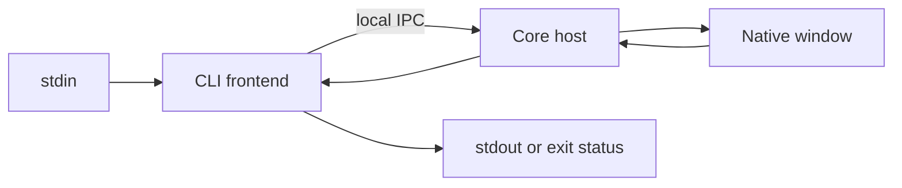

# CLI architecture

The CLI is a standalone Rust process supervising a Core host session over local authenticated wire v1. Its command parsing, input framing, output formatting and exit status semantics are owned by this repository. Core is the renderer and owns GUI events. SDK packages do not depend on or invoke the CLI.

No native application data is sent to a remote server. Form fragments and optional CSS are trusted developer inputs, while external stream rows are escaped before rendering.
