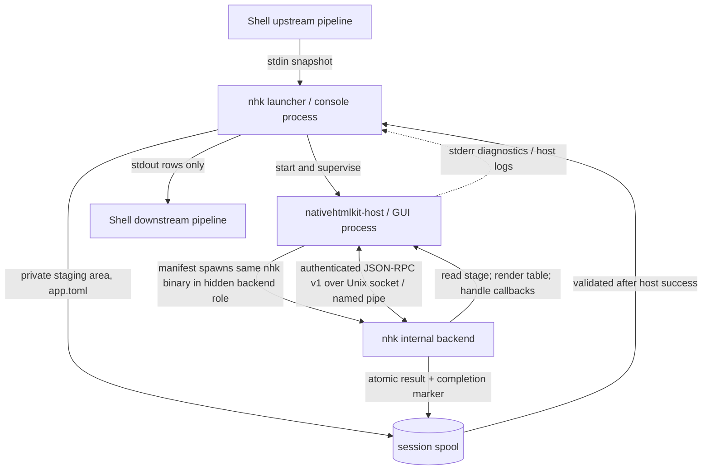

# Architecture — boundaries and deployment

## Selected pattern: same CLI binary, two roles, existing host



Rationale: protects Core's existing ownership of native event loop and accessibility; proves protocol independent of Python/PowerShell; shell facing `nhk` can keep stdout and stdin while GUI host still owns window lifecycle.

## Why not embed renderer directly into `nhk`?

- Would make the first CLI **not** prove the IPC host contract used by Python and PowerShell.
- Introduces a second way to own native event loops, supervision, resources and platform-specific behavior.
- Makes the Rust Core library more public and ABI-sensitive before its boundaries are qualified.

## Why not make PowerShell or Python a CLI driver?

- Adds a runtime dependency and fails the primary goal: test a pure Rust consumer.
- Creates duplicate GUI processing and disrupts planned independent SDK releases.

## Future alternatives

- A dedicated `nhk-backend` executable could isolate launcher/backend options, but increases packaging footprint. Keep one binary until compelling reasons appear.
- A separate result pipe/socket could replace disk staging, but requires careful Windows/Unix handle inheritance and corruption/deadlock handling. Prefer secure atomic file handoff for the first milestone.
- Direct in-process Rust API may later be offered as `nativehtmlkit-rust`, independent of the CLI. Not required to start.

## Module map

```text
crates/nativehtmlkit-cli/
  Cargo.toml                  # Rust binary 'nhk'
  src/main.rs                # clap entry / two roles
  src/args.rs                # external versioned CLI options
  src/exit.rs                # exact exit status taxonomy
  src/launcher.rs            # stdin, host launch, stdout
  src/host_locator.rs        # locate pinned native host
  src/session.rs             # private temp dir + manifest
  src/staging.rs             # bounded parse and write
  src/dataset.rs             # stable row index + original values
  src/output.rs              # output serialization, pipe failures
  src/backend.rs             # internal app run loop
  src/ipc.rs                 # strict JSON-RPC v1 client and callbacks
  src/selection.rs           # selection model / search / pagination
  src/ui/templates.rs        # trusted HTML generator + styling
  src/ui/events.rs           # native events to domain actions
  src/commit.rs              # atomic submit/cancel result handoff
  tests/                    # parser, mock host, real-host, native
```

The file map is suggested, not a requirement for exact Rust filenames. Prefer modules whose tests can run headlessly. Avoid a generic UI component framework in this CLI crate: it should showcase the engine, not reinvent the higher-level NativeHTMLKit UI library.

## Ownership boundaries

| Owner | Allowed | Forbidden |
|---|---|---|
| Core host | native windows, HTML/CSS, event loop, private IPC server, native dialogs, supervision | parsing shell input, emitting CLI row results, knowing CSV semantics |
| CLI launcher | CLI args, stdin, input format parsing, stage, child launch, status, stdout | direct GUI window ownership, user callbacks in host event loop |
| CLI backend | read staged records, HTML generation, selection/form state, handle JSON-RPC callbacks, atomic result receipt | write pipeline data to stdout; run upstream/downstream shell commands |
| NativeHTMLKit UI | optional future CSS/widgets and layouts for SDK apps | required CLI runtime dependency for first proof |
| Python/PowerShell SDKs | independent host protocol clients | required dependency of Rust CLI |

## Protocol compatibility

Existing host environment names `UI4ME_ENDPOINT`, `UI4ME_TOKEN`, `UI4ME_APP_ID`, and `UI4ME_PROTOCOL_VERSION` are **wire compatibility names** in v1. Rebrand outward user names first, but don't silently rename these variables and break the host handshake. Record the eventual namespace transition as an explicit protocol-version change, with compatibility aliases and tests.

The `nhk` backend must always send `host.hello` and validate `protocol_version` and required returned capabilities before using commands; `host_version` alone is not a compatibility mechanism.
